<div align="center">

# 가려짐에 강건한 컨베이어 위 화물 치수 추정 및 트럭 적재 최적화

**기하 스케일 분리와 형태비 학습에 기반한 단안 CCTV 화물 치수 추정**

<!-- 배지: GitHub 아이디/저장소 이름으로 바꾸기 -->
[](https://colab.research.google.com/github/[USER]/Box-Sizing/blob/main/notebooks/03_sizing_MAIN_offline_test.ipynb)
&nbsp;[📄 최종 보고서](docs/report.pdf)

</div>

일반 CCTV 한 대의 영상과 렌즈 focal만으로 컨베이어 위 상자의 **가로 · 세로 · 높이(w · d · h)** 를 추정하고, 추정한 치수로 **트럭 적재를 최적화**합니다 (3D bin packing).

## 🎬 데모 — 영상 하나로 처음부터 끝까지 (test_033)

<!-- 영상 · 표 만드는 법: HOWTO_media.md 0번 (make_demo · demo_table) -->

**① 입력 영상 → 검출 · 추적 · 치수 추정**

https://github.com/user-attachments/assets/[영상-링크]

<sub>상자마다 추적 번호와 추정 치수(가로 × 세로 × 높이, cm)가 표시됩니다. 정답 치수는 회색으로 함께 표시.</sub>

**② 트랙별 결과**

<p align="center">
  <br>
  <sub>트랙마다 대표 crop과 가려짐(왼쪽), 같은 축척으로 그린 예측(주황) · 정답(초록 점선) 3D 상자(오른쪽)</sub>
</p>

**③ 측정값**

<!-- demo_table()이 출력한 표로 바꾸기 -->
| 트랙 | 추정 (cm) | 정답 (cm) | 오차 (cm) |
|---|---|---|---|
| T0 | __ × __ × __ | __ × __ × __ | __ |
| … | | | |
| **평균** | | | **__** |

**④ 트럭 적재 최적화**

<p align="center">
  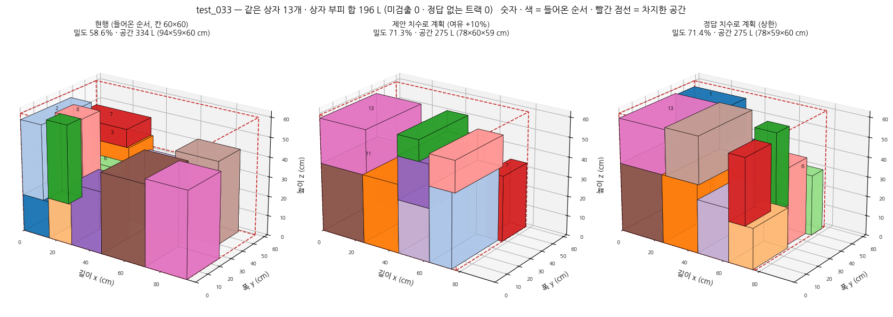<br>
  <sub>같은 영상의 상자 13개를 세 방식으로 실은 모습 (같은 축척): 들어온 순서대로 · 추정 치수로 계획 · 정답 치수로 계획</sub>
</p>

## 📊 한눈에 보기

| | 결과 |
|---|---|
| **치수 오차 (test)** | **1.75 cm (8.9%)**, 95% CI [1.58, 1.93] |
| 비교: OVMono3D-LIFT | 원본 8.68 cm · 레일 보정 6.81 cm · 레일 + 현장 데이터 fine tuning 3.44 cm |
| **온라인 처리** | 상자가 ROI 중간을 지나는 순간(등장 후 중앙값 3.7초) 측정, test 오차 1.80 cm |
| **런타임 (A100)** | 상자당 치수 추정 약 0.19초 · 전체 파이프라인 영상 길이의 0.26배 (고정 카메라) |
| **트럭 적재 최적화** | 적재 밀도 58.0% → **66.1%** (+8.0%p), 같은 상자를 약 14% 작은 공간에 적재 |

모든 모델 선택은 train · val로만 했고, 최종 모델로 test를 마지막에 한 번 평가했습니다.

## ❓ 문제

<p align="center">
  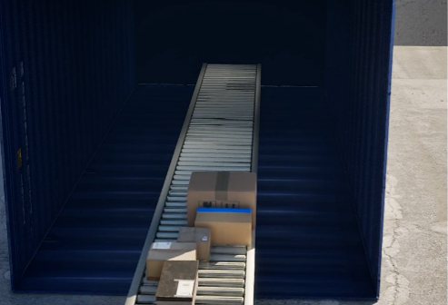  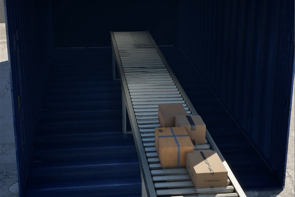<br>
  <sub>합성 상차 CCTV (Unreal Engine) — 상자가 서로 가리고, 비스듬히 놓여 있다</sub>
</p>

단안 CCTV로 상자 크기를 재기 어려운 이유는 세 가지입니다.
1. **절대 크기를 모름:** 가까운 작은 상자와 먼 큰 상자가 같게 찍힙니다.
2. **가려짐:** 상자끼리 가려 모서리를 찾는 고전적 기하 계산이 성립하지 않습니다.
3. **가로 · 세로의 혼합:** 화면 축 bbox의 가로에 비스듬한 상자의 가로와 세로가 섞입니다.

## 💡 방법: 크기를 셋으로 나눈다

<p align="center">
  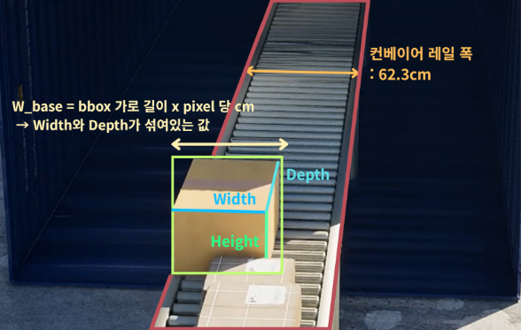 
</p>

| 단계 | 계산 | |
|---|---|---|
| 기하 스케일 | 레일 폭 62.3 cm → 상자가 놓인 높이의 픽셀당 cm | 계산 |
| 가로 w | bbox 가로 × 픽셀당 cm × **점유율 B** | STEP 1 (학습) |
| 세로 d · 높이 h | w × **형태비** (d/w, h/w) | STEP 2 (학습) |

<p align="center">
  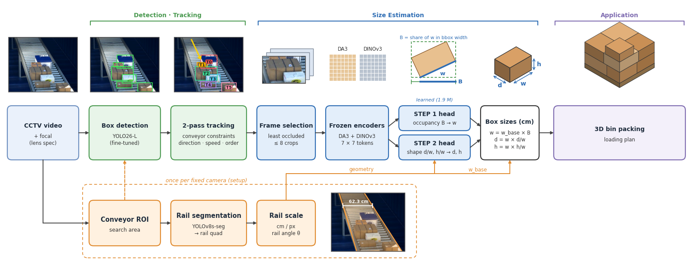<br>
  <br>
  <sub>최종 파이프라인 — 가려짐 적은 프레임 최대 8장 · 고정 Depth Anything 3 인코더 + DINOv3-L 패치 토큰 · 작은 head 2개 (학습 1.9 M)</sub>
</p>

<details>
<summary><b>검출 · 추적 · 레일 (펼치기)</b></summary>

<p align="center">
  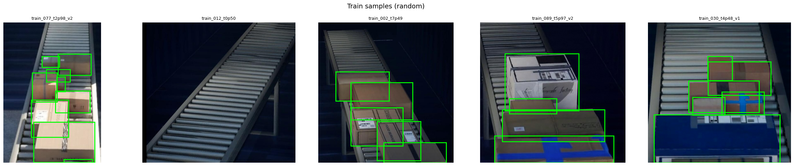<br>
  <sub>Grounding DINO 자동 라벨 → Label Studio 수작업 수정 → 증강으로 만든 학습 데이터</sub>
</p>
<p align="center">
  <br>
  <sub>YOLO26-L fine tuning 학습 곡선</sub>
</p>
<p align="center">
  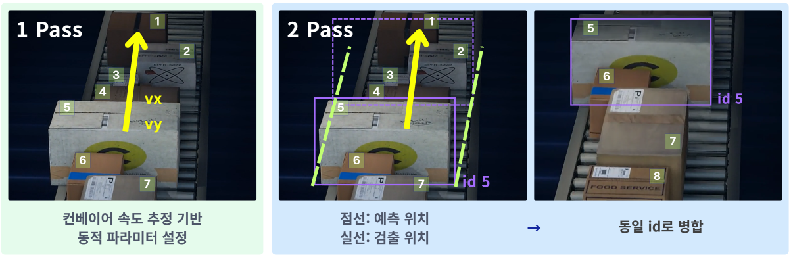<br>
  <sub>컨베이어 제약(한 방향 · 일정 속도 · 들어온 순서)을 넣은 2-pass 추적</sub>
</p>
<p align="center">
  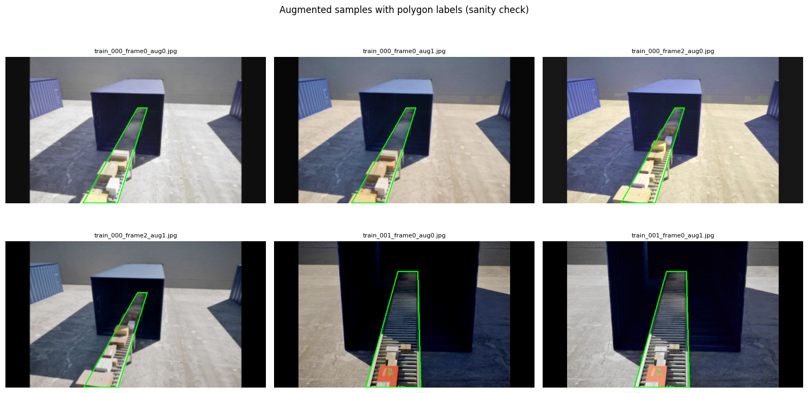<br>
  <sub>레일 분할과 기하 스케일 — 레일 폭 62.3 cm가 영상 안의 자</sub>
</p>
</details>

## 📈 단계별 개선

질문 하나 → 바꾼 것 하나 → 결과 → 다음 질문. 미리 정한 판정 규칙(train · val 모두 0.03 cm 넘게 개선)으로 7단계에 걸쳐 개선했습니다.

<p align="center">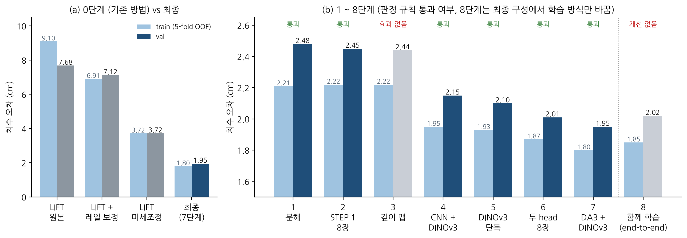</p>

| 단계 | 질문 | 결과 (val) |
|---|---|---|
| 1 | 크기를 나누면? | 2.48 cm — 분해가 핵심 |
| 2 | 가려짐 대응은? (STEP 1을 8장 평균) | 2.45 cm — 병목은 형태비 |
| 3 | 깊이 맵을 주면? | 2.44 cm — 효과 없음 |
| 4 | 자기지도 표현(DINOv3)은? | 2.15 cm — 공간 배치가 핵심 |
| 5 | CNN이 필요한가? | 2.10 cm — 결합 불필요 |
| 6 | 두 단계 모두 · 여러 시점으로? | 2.01 cm |
| **7** | **깊이 모델의 내부 표현은?** | **1.95 cm — 최종** |
| 8 | 두 head를 함께 학습하면? | 개선 없음 → 분리 학습 유지 |

<details>
<summary><b>근거 실험 그림 (펼치기)</b></summary>

| | |
|---|---|
| <br><sub>분해의 필요성</sub> | <br><sub>STEP 1 가로 w 오차</sub> |
| <br><sub>공간 배치의 효과</sub> | <br><sub>CNN 결합 검증</sub> |
| <br><sub>여러 시점의 효과</sub> | <br><sub>깊이 모델 내부 표현의 결합</sub> |
| 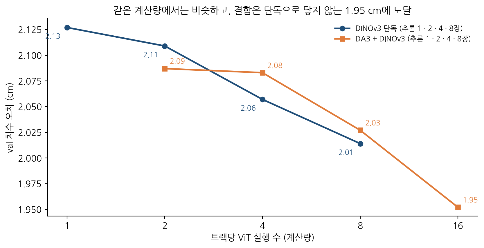<br><sub>같은 계산량 비교</sub> | <br><sub>2-C 구조 (CNN + DINOv3)</sub> |
</details>

## 🧪 결과

<p align="center">
  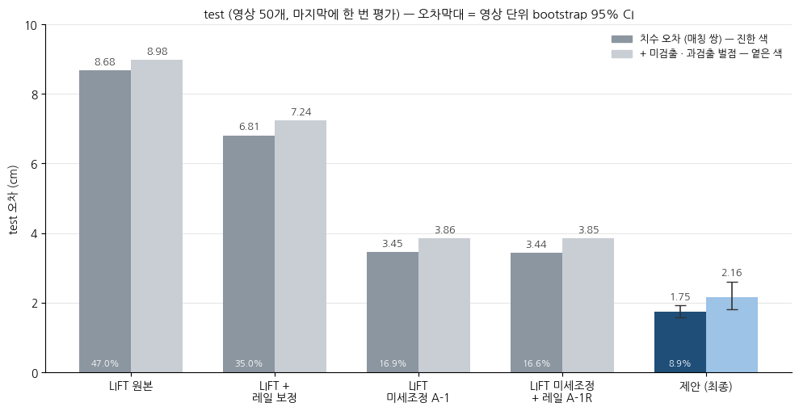<br>
  <sub>test 치수 오차 — 기존 방법과의 비교</sub>
</p>

<details>
<summary><b>기존 방법은 왜 안 되나 (펼치기)</b></summary>

<p align="center">
  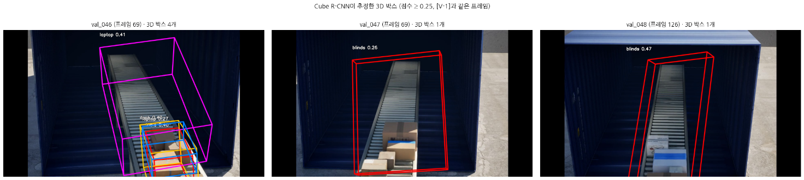<br>
  <sub>Cube R-CNN: 개별 상자를 검출하지 못하고 장면을 뭉뚱그린 박스가 엉뚱한 클래스로 나온다</sub>
</p>
<p align="center">
  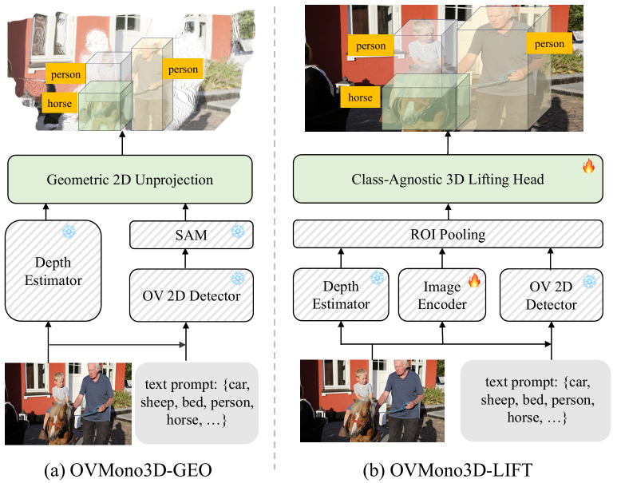<br>
  <br>
  <sub>OVMono3D-LIFT: 레일 보정은 스케일만 고치고 형태가 틀린 상자는 그대로 틀린다</sub>
</p>
</details>

<details>
<summary><b>구간별 성능 · 남은 오차 · 실패 사례 (펼치기)</b></summary>

<p align="center">
  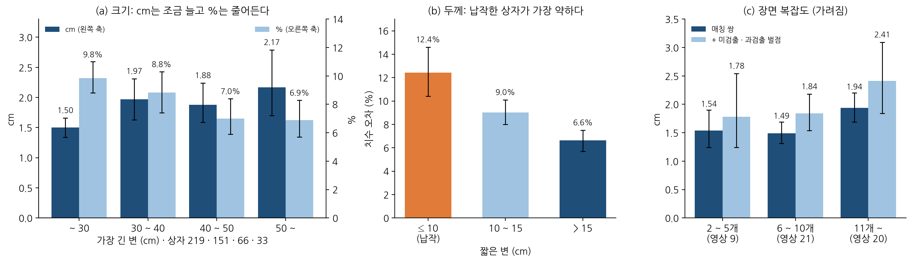<br><sub>test 구간별 성능 (95% CI)</sub><br><br>
  <br><sub>남은 오차의 분해</sub><br><br>
  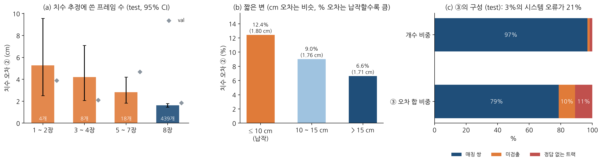<br><sub>실패 사례 분석 — 큰 오차의 대부분은 bbox가 상자의 실제 범위와 다를 때</sub>
</p>
</details>

## ⚡ 온라인 처리와 런타임

<p align="center">
  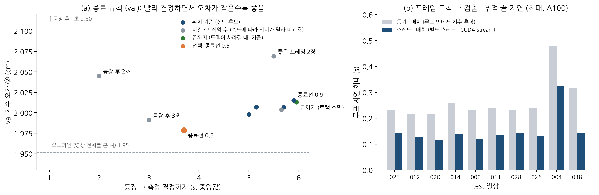<br>
  <sub>상자가 ROI 중간을 지나는 순간 측정 (등장 후 중앙값 3.7초), 0.1초 간격의 프레임 흐름을 지연 없이 따라감</sub>
</p>
<p align="center">
  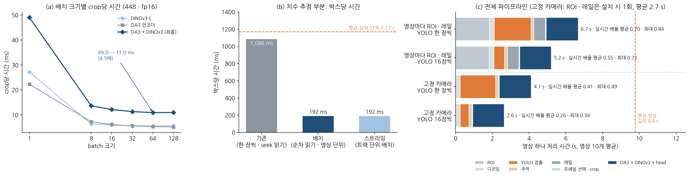<br>
  <sub>런타임 (A100) — 배치 처리로 상자당 시간 5.6배 감소, 전체 파이프라인도 영상 길이보다 빠름</sub>
</p>

## 📦 트럭 적재 최적화 (3D bin packing)

추정한 치수로 상자를 싣는 순서와 구역을 정하고, 실제 치수의 상자로 실었을 때 차지하는 공간을 비교했습니다 (미검출 상자 · 정답 없는 트랙 포함).

<p align="center">
  <br>
  <sub>test 적재 밀도 — 현행 58.0% → 제안 66.1% (정답 치수 상한 72.3%)</sub>
</p>

## 📁 저장소 구조

| 노트북 | 내용 | Colab |
|---|---|---|
| `01_baseline_CubeRCNN_detection` | 기존 방법 1: Cube R-CNN | [](https://colab.research.google.com/github/[USER]/Box-Sizing/blob/main/notebooks/01_baseline_CubeRCNN_detection.ipynb) |
| `02_baseline_OVMono3D_LIFT` | 기존 방법 2: OVMono3D-LIFT | [](https://colab.research.google.com/github/[USER]/Box-Sizing/blob/main/notebooks/02_baseline_OVMono3D_LIFT.ipynb) |
| **`03_sizing_MAIN_offline_test`** | **최종 모델: 학습 · 추론 · test 채점 · 런타임** | [](https://colab.research.google.com/github/[USER]/Box-Sizing/blob/main/notebooks/03_sizing_MAIN_offline_test.ipynb) |
| `04_sizing_ablation` | 단계별 개선 (0 ~ 8단계) | [](https://colab.research.google.com/github/[USER]/Box-Sizing/blob/main/notebooks/04_sizing_ablation.ipynb) |
| `05_sizing_failure_analysis` | 실패 사례 분석 | [](https://colab.research.google.com/github/[USER]/Box-Sizing/blob/main/notebooks/05_sizing_failure_analysis.ipynb) |
| `06_sizing_online_realtime` | 온라인 처리 | [](https://colab.research.google.com/github/[USER]/Box-Sizing/blob/main/notebooks/06_sizing_online_realtime.ipynb) |
| `07_binpacking` | 트럭 적재 최적화 (3D bin packing) | [](https://colab.research.google.com/github/[USER]/Box-Sizing/blob/main/notebooks/07_binpacking.ipynb) |

```
.
├── notebooks/        # 위 7개 노트북
├── assets/           # README 그림 · 영상(GIF)
├── docs/report.pdf   # 최종 보고서
├── requirements.txt
└── README.md
```

## ⚙️ 실행 환경 · 데이터 · 가중치

- Google Colab GPU 런타임 (L4 또는 A100), Python 3.13, PyTorch 2.11, `timm>=1.0.20`, `ultralytics`
- **데이터**는 저장소에 포함하지 않습니다. [데이터 출처 · 이용 조건] 각 노트북 첫 셀의 `ROOT` 경로만 바꾸면 됩니다.
- **가중치**: 직접 학습한 YOLO(검출 · 레일 분할)와 최종 head(5-fold)는 [Releases](https://github.com/[USER]/Box-Sizing/releases)에서 받아 `checkpoints/`에 둡니다. DINOv3 · Depth Anything 3는 노트북이 공식 경로에서 자동으로 받습니다.

## ⚠️ 한계

- 합성 데이터에서만 검증 (실제 CCTV의 조명 · 압축 노이즈 · 렌즈 왜곡은 미확인)
- 레일 폭을 기준물로 사용 — 레일이 보이고 폭을 알아야 함
- bbox가 상자의 실제 범위와 다를 때(가려짐 · 잘림), 가로 w의 모호함, 납작한 상자가 남은 과제

## 📚 참고

Cube R-CNN (Brazil et al., CVPR 2023) · OVMono3D (Yao et al., arXiv:2411.16833) · DINOv3 (Siméoni et al., 2025) · Depth Anything 3 (Lin et al., 2025) · ByteTrack (Zhang et al., ECCV 2022) · 3D-bin-packing (jerry800416)

## 📄 라이선스

코드: [MIT]. 기반 모델(DINOv3, Depth Anything 3, YOLO)은 각 라이선스를 따릅니다.
