<div align="center">

# 가려짐에 강건한 컨베이어 위 화물 치수 추정 및 트럭 적재 최적화

**기하 스케일 분리와 형태비 학습에 기반한 단안 CCTV 화물 치수 추정**

[](https://colab.research.google.com/github/olchan/Box-Sizing/blob/main/03_sizing_MAIN_offline_test.ipynb)
&nbsp;[📄 최종 보고서](캡스톤디자인_최종보고서_이찬.pdf)

</div>

일반 CCTV 한 대의 영상과 렌즈 focal만으로 컨베이어 위 상자의 **가로 · 세로 · 높이(w · d · h)** 를 추정하고, 추정한 치수로 **트럭 적재를 최적화**합니다 (3D bin packing).

## 🚚 배경: 왜 CCTV로 재야 하나

트럭 적재를 최적화하려면 실리는 상자 하나하나의 가로 · 세로 · 높이를 미리 알아야 합니다. 그러나 현장에서 쓰는 **전용 체적 측정 센서(스캐너)** 는

- 상자를 **겹침 없이 하나씩** 통과시켜야 측정할 수 있고,
- 장비가 **고가**라 모든 상차 라인에 두기 어렵습니다.

그래서 상자가 붙어서 들어오고 서로 가리는 실제 상차 라인이나 센서가 없는 창고에서는 치수를 모른 채, 작업자의 경험에 의존해 싣게 되고 적재 공간이 낭비됩니다. 반면 대부분의 창고에는 **CCTV가 이미 설치**되어 있습니다.

## 🎯 이 프로젝트

이미 있는 **CCTV 한 대**의 영상으로 컨베이어 위 상자의 치수를 재고, 그 치수로 트럭 적재를 계획합니다.

<p align="center">
   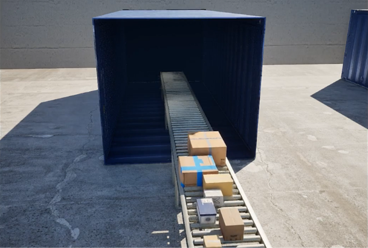 <br>
  <sub>합성 상차 CCTV (Unreal Engine) — 상자가 서로 가리고, 비스듬히 놓여 있다</sub>
</p>

단안 CCTV로 상자 크기를 재기 어려운 이유는 세 가지입니다.
1. **절대 크기를 모름:** 가까운 작은 상자와 먼 큰 상자가 같게 찍힙니다.
2. **가려짐:** 상자끼리 가려 모서리를 찾는 고전적 기하 계산이 성립하지 않습니다.
3. **가로 · 세로의 혼합:** 화면 축 bbox의 가로에 비스듬한 상자의 가로와 세로가 섞입니다.

## 🎬 데모 — 영상 하나로 처음부터 끝까지 (test_005)

test 영상 중 상자 11개가 지나가는 test_005 하나로 **실시간 측정 → 상자별 결과 → 트럭 적재**까지 따라갑니다. 치수 오차가 test 전체 평균과 비슷한 전형적인 예시입니다.

**① 실시간 처리 영상** — 0.1초마다 들어오는 프레임을 한 장씩 처리하고, 상자가 종료선(파란 선)을 지나는 순간 치수를 냅니다.

https://github.com/user-attachments/assets/6b83b3b6-b371-4793-bb71-3a92f14f7629

<sub>회색 = 추적 중 · 노랑 = 측정 중 · 초록 = 치수 나옴 (정답과 비교) · 주황 = 치수 나옴, 정답 없는 트랙 · 점선 사각형 = ROI</sub>

**② 상자별 측정 결과**

<p align="center">
  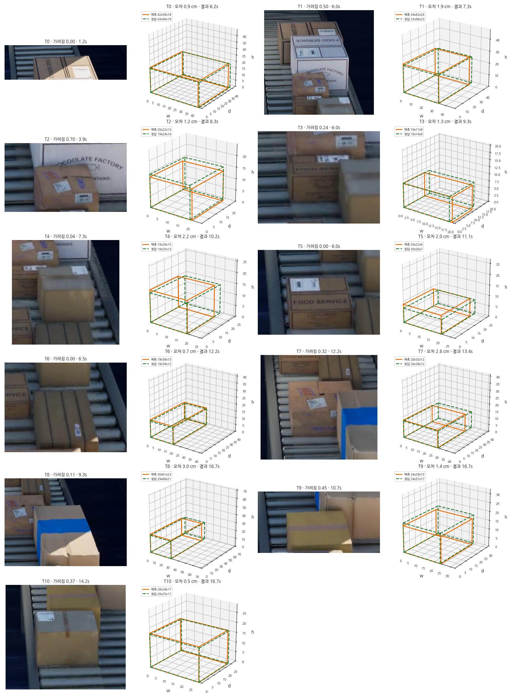<br>
  <sub>상자마다 치수 추정에 쓴 프레임 중 가려짐이 가장 적은 crop(왼쪽)과, 같은 축척으로 그린 예측(주황) · 정답(초록 점선) 3D 상자(오른쪽)</sub>
</p>

**③ 적재 계획에 쓴 치수**

<p align="center">
  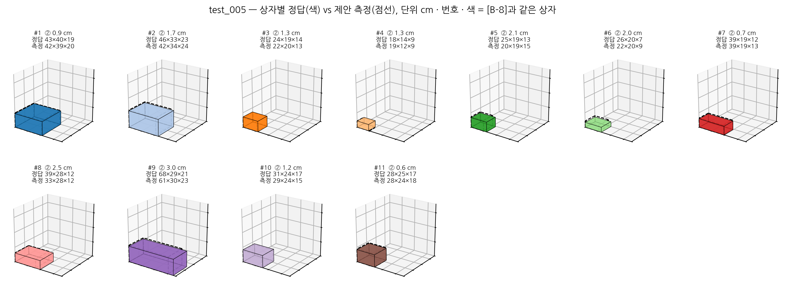<br>
  <sub>상자별 정답(색 채운 상자)과 추정 치수(검은 점선) — 번호 · 색은 ④와 같은 상자</sub>
</p>

**④ 트럭 적재 최적화**

<p align="center">
  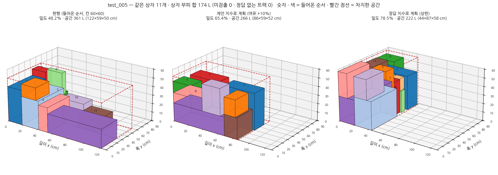<br>
  <sub>같은 상자를 세 방식으로 실은 모습 (같은 축척): 들어온 순서대로 · 추정 치수로 계획 · 정답 치수로 계획 — 숫자 · 색 = 들어온 순서, 빨간 점선 = 차지한 공간</sub>
</p>

## 📊 한눈에 보기

| | 결과 |
|---|---|
| **치수 오차 (test)** | **1.75 cm (8.9%)**, 95% CI [1.58, 1.93] |
| 비교: OVMono3D-LIFT | 원본 8.68 cm · 레일 보정 6.81 cm · 레일 + 현장 데이터 fine tuning 3.44 cm |
| **온라인 처리** | 상자가 ROI 중간을 지나는 순간(등장 후 중앙값 3.7초) 측정, test 오차 1.80 cm |
| **런타임 (A100)** | 상자당 치수 추정 약 0.19초 · 전체 파이프라인 영상 길이의 0.26배 (고정 카메라) |
| **트럭 적재 최적화** | 적재 밀도 58.0% → **66.1%** (+8.0%p), 같은 상자를 약 14% 작은 공간에 적재 |

모든 모델 선택은 train · val로만 했고, 최종 모델로 test를 마지막에 한 번 평가했습니다.

## 💡 방법: 크기를 셋으로 나눈다

<p align="center">
  
</p>

| 단계 | 계산 | |
|---|---|---|
| 기하 스케일 | 레일 폭 62.3 cm → 상자가 놓인 높이의 픽셀당 cm | 계산 |
| 가로 w | bbox 가로 × 픽셀당 cm × **점유율 B** | STEP 1 (학습) |
| 세로 d · 높이 h | w × **형태비** (d/w, h/w) | STEP 2 (학습) |

<p align="center">
  <br>
  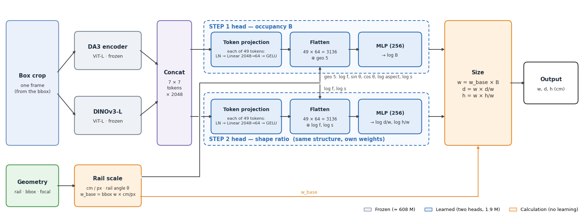<br>
  <sub>최종 파이프라인 — 가려짐 적은 프레임 최대 8장 · 고정 Depth Anything 3 인코더 + DINOv3-L 패치 토큰 · 작은 head 2개 (학습 1.9 M)</sub>
</p>

<details>
<summary><b>검출 · 추적 · 레일</b></summary>

<p align="center">
  <br>
  <sub>Grounding DINO 자동 라벨 → Label Studio 수작업 수정 → 증강으로 만든 학습 데이터</sub>
</p>
<p align="center">
  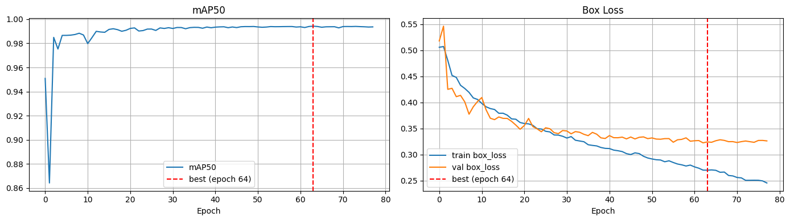<br>
  <sub>YOLO26-L fine tuning 학습 곡선</sub>
</p>
<p align="center">
  <br>
  <sub>컨베이어 제약(한 방향 · 일정 속도 · 들어온 순서)을 넣은 2-pass 추적</sub>
</p>
<p align="center">
  <br>
  <sub>레일 분할과 기하 스케일 — 레일 폭 62.3 cm가 영상 안의 자</sub>
</p>
</details>

## 📈 단계별 개선

질문 하나 → 바꾼 것 하나 → 결과 → 다음 질문. 미리 정한 판정 규칙(train · val 모두 0.03 cm 넘게 개선)으로 7단계에 걸쳐 개선했습니다.

<p align="center"></p>

| 단계 | 질문 | 결과 (val) |
|---|---|---|
| 1 | 크기를 나누면? | 2.48 cm — 분해가 핵심 |
| 2 | 가려짐 대응은? (STEP 1을 8장 평균) | 2.45 cm — 병목은 형태비 |
| 3 | 깊이 맵을 주면? | 2.44 cm — 효과 없음 |
| 4 | 자기지도 표현(DINOv3)은? | 2.15 cm — 공간 배치가 핵심 |
| 5 | CNN이 필요한가? | 2.10 cm — 결합 불필요 |
| 6 | 두 단계 모두 · 여러 시점으로? | 2.01 cm |
| **7** | **깊이 모델의 내부 표현은?** | **1.95 cm — 최종** |
| 8 | 두 head를 함께 학습하면? | 개선 없음 → 분리 학습 유지 |

<details>
<summary><b>근거 실험 그림</b></summary>

| | |
|---|---|
| 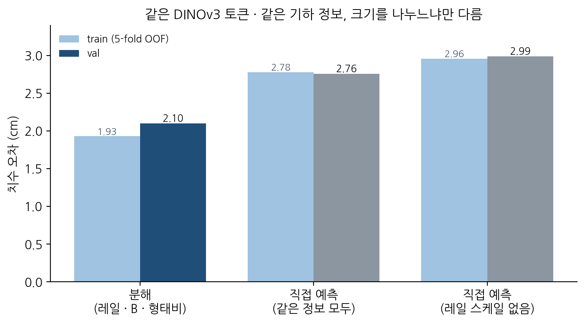<br><sub>분해의 필요성</sub> | 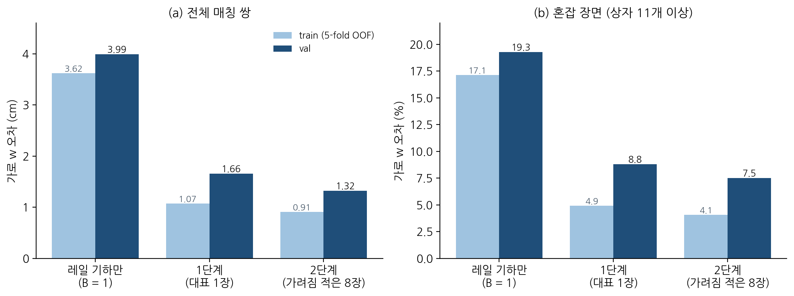<br><sub>STEP 1 가로 w 오차</sub> |
| 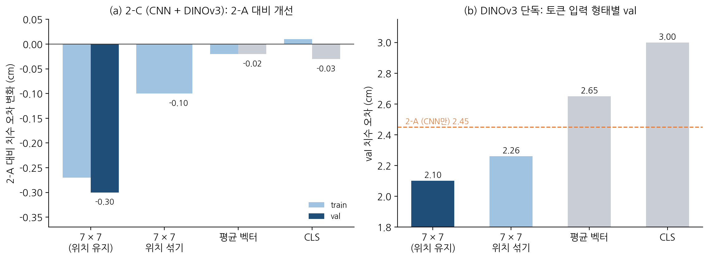<br><sub>공간 배치의 효과</sub> | 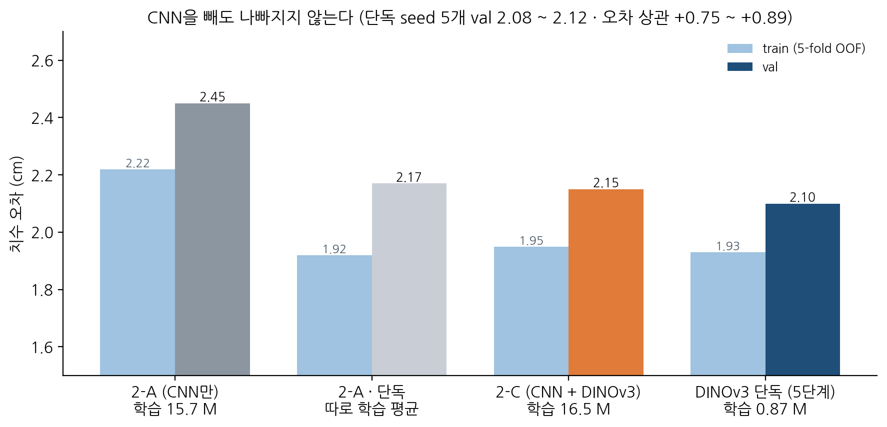<br><sub>CNN 결합 검증</sub> |
| 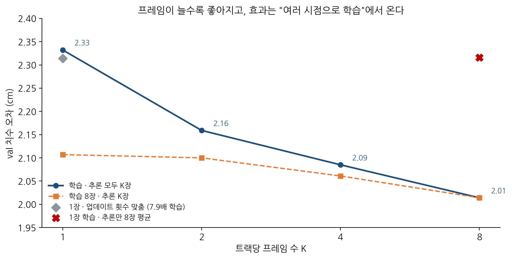<br><sub>여러 시점의 효과</sub> | 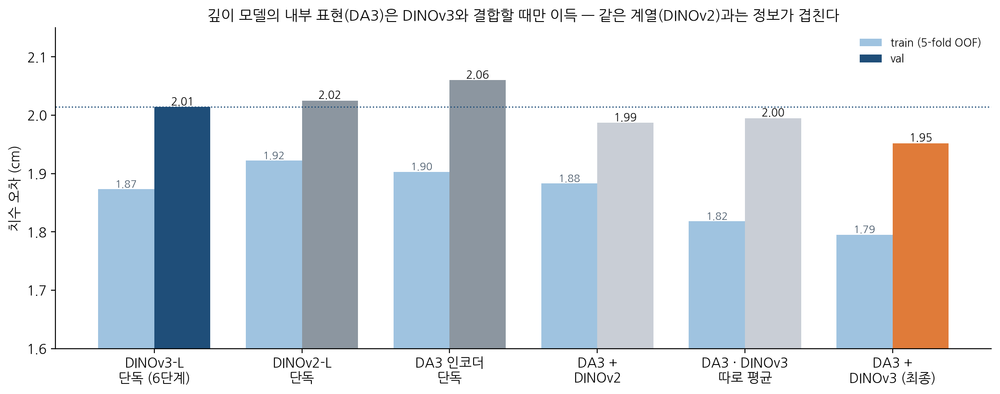<br><sub>깊이 모델 내부 표현의 결합</sub> |
| <br><sub>같은 계산량 비교</sub> | 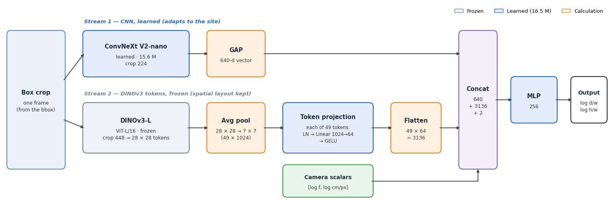<br><sub>2-C 구조 (CNN + DINOv3)</sub> |
</details>

## 🧪 결과

<p align="center">
  <br>
  <sub>test 치수 오차 — 기존 방법과의 비교</sub>
</p>

<details>
<summary><b>기존 방법은 왜 안 되나</b></summary>

<p align="center">
  <br>
  <sub>Cube R-CNN: 개별 상자를 검출하지 못하고 장면을 뭉뚱그린 박스가 엉뚱한 클래스로 나온다</sub>
</p>
<p align="center">
  <br>
  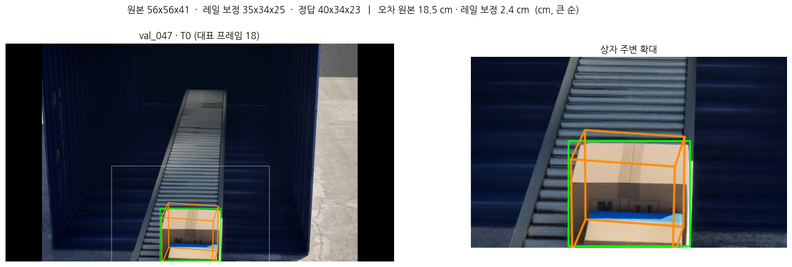<br>
  <sub>OVMono3D-LIFT: 레일 보정은 스케일만 고치고 형태가 틀린 상자는 그대로 틀린다</sub>
</p>
</details>

<details>
<summary><b>구간별 성능 · 남은 오차</b></summary>

<p align="center">
  <br><sub>test 구간별 성능 (95% CI)</sub><br><br>
  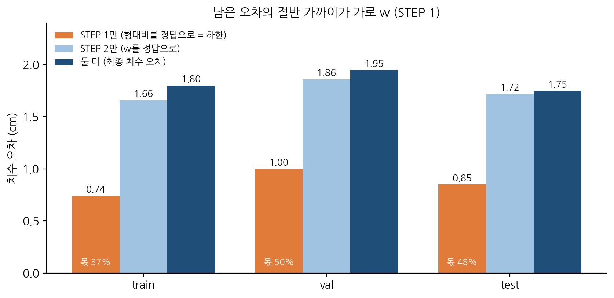<br><sub>남은 오차의 분해 — 남은 오차의 절반 가까이가 가로 w</sub>
</p>
</details>

## 🔍 실패 분석: 언제 크게 틀리나

상자별 오차는 중앙값 1.36 cm로 대부분 작지만, **오차 상위 10%(≥ 3 cm)가 전체 오차의 30%** 를 차지합니다. 이 실패가 언제 생기는지 최종 모델을 그대로 두고 분석했습니다 (모든 결과는 val에서도 같은 경향).

**가림 — 한 장은 나빠지지만, 여러 장이 흡수한다.** 앞 상자에 절반 넘게 가린 프레임 한 장으로 재면 2.74 cm로 커지고, 같은 상자를 많이 가린 3장으로 재면 덜 가린 3장보다 +0.27 cm [+0.15, +0.38] 나빠집니다. 그러나 가림 적은 프레임을 여러 장 쓰면 1장 1.97 → 8장 1.74 cm로 줄어, 최종 결과에서는 가림의 영향이 대부분 흡수됩니다.

<p align="center">
  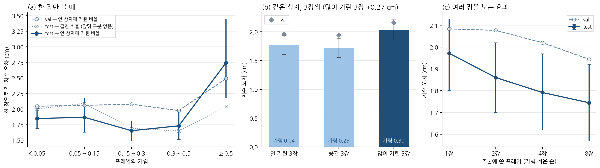<br>
  <sub>(a) 프레임 한 장의 가림 구간별 오차 (b) 같은 상자를 3장씩 (c) 쓴 프레임 수</sub><br><br>
  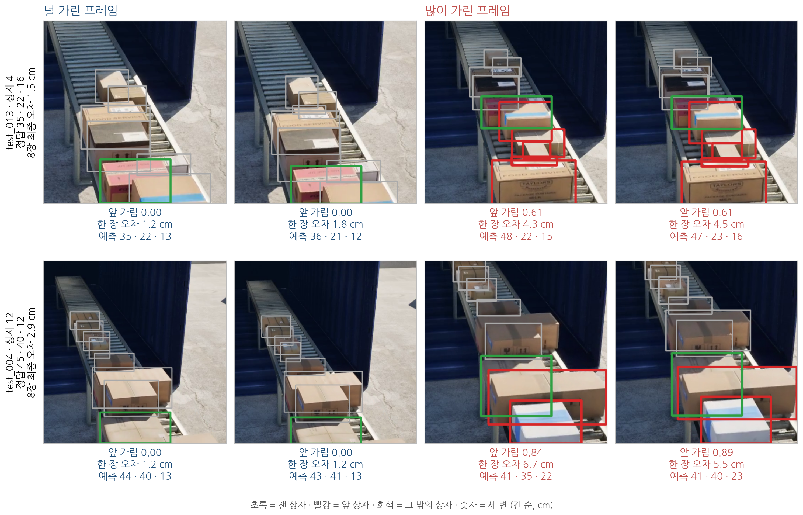<br>
  <sub>같은 상자를 덜 가린 프레임 · 많이 가린 프레임으로 잰 예 (초록 = 잰 상자, 빨강 = 앞 상자)</sub>
</p>

**형태 — 아주 납작하거나 길쭉한 상자가 어렵다.** 납작함(짧은 변 ÷ 긴 변) < 0.3인 상자는 2.60 cm, 길쭉한 상자는 2.32 cm로 나머지(1.41 ~ 1.83 cm)보다 크고, 축별로는 세로 d가 가장 많이 틀립니다. 가림 없이 잘 보이는 긴 상자도 긴 변을 짧게 잽니다.

<p align="center">
  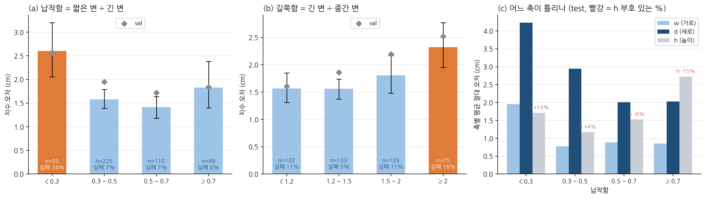<br>
  <sub>(a) 납작함 (b) 길쭉함 구간별 오차 (c) 축별 오차</sub>
</p>

**짧은 트랙 — 흡수가 안 되는 경우.** 가려져 잠깐만 보이고 끊긴 트랙은 쓸 프레임이 적어, 8장을 쓴 상자(1.63 cm)와 달리 1 ~ 2장만 쓴 상자는 5.28 cm였습니다. 형태 · 가림을 함께 넣은 다변수 회귀에서도 test · val 모두 유의한 요인은 쓴 프레임 수와 길쭉함이었습니다.

## ⚡ 온라인 처리와 런타임

현장에서는 영상이 끝날 때까지 기다릴 수 없으므로, 0.1초마다 들어오는 프레임을 한 장씩 처리하다가 **상자가 ROI 중간(종료선)을 지나는 순간** 그때까지 모인 프레임으로 치수를 냅니다 (위 데모 영상).

| 처리 방식 | 치수가 나오는 시점 | test 치수 오차 |
|---|---|---|
| 오프라인 (영상 전체를 본 뒤) | 영상이 끝난 뒤 | 1.75 cm |
| **온라인 (종료선 0.5)** | **상자 등장 후 중앙값 3.7초** | **1.80 cm** |

결과가 훨씬 빨리 나오지만 오차는 거의 같고, 치수 추정을 별도 스레드로 처리해 0.1초 간격의 프레임 흐름을 지연 없이 따라갑니다.

<p align="center">
  <br>
  <sub>런타임 (A100) — 배치 처리로 상자당 시간 5.6배 감소, 전체 파이프라인도 영상 길이보다 빠름</sub>
</p>

## 📦 트럭 적재 최적화 (3D bin packing)

추정한 치수로 상자를 싣는 순서와 구역을 정하고, 실제 치수의 상자로 실었을 때 차지하는 공간을 비교했습니다 (미검출 상자 · 정답 없는 트랙 포함).

<p align="center">
  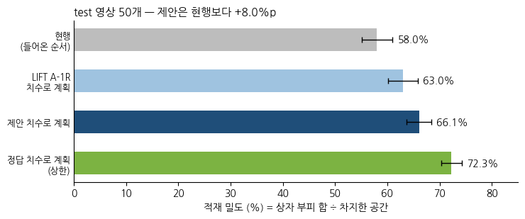<br>
  <sub>test 적재 밀도 — 현행 58.0% → 제안 66.1% (정답 치수 상한 72.3%)</sub>
</p>

## 📁 저장소 구조

| 노트북 | 내용 | Colab |
|---|---|---|
| `01_baseline_CubeRCNN_detection` | 기존 방법 1: Cube R-CNN | [](https://colab.research.google.com/github/olchan/Box-Sizing/blob/main/01_baseline_CubeRCNN_detection.ipynb) |
| `02_baseline_OVMono3D_LIFT` | 기존 방법 2: OVMono3D-LIFT | [](https://colab.research.google.com/github/olchan/Box-Sizing/blob/main/02_baseline_OVMono3D_LIFT.ipynb) |
| **`03_sizing_MAIN_offline_test`** | **최종 모델: 학습 · 추론 · test 채점 · 런타임** | [](https://colab.research.google.com/github/olchan/Box-Sizing/blob/main/03_sizing_MAIN_offline_test.ipynb) |
| `04_sizing_ablation` | 단계별 개선 (0 ~ 8단계) | [](https://colab.research.google.com/github/olchan/Box-Sizing/blob/main/04_sizing_ablation.ipynb) |
| `05_sizing_failure_analysis` | 실패 분석: 가림 · 형태 · 실제 영상 사례 | [](https://colab.research.google.com/github/olchan/Box-Sizing/blob/main/05_sizing_failure_analysis.ipynb) |
| `06_sizing_online_realtime` | 온라인 처리 | [](https://colab.research.google.com/github/olchan/Box-Sizing/blob/main/06_sizing_online_realtime.ipynb) |
| `07_binpacking` | 트럭 적재 최적화 (3D bin packing) | [](https://colab.research.google.com/github/olchan/Box-Sizing/blob/main/07_binpacking.ipynb) |

```
├── 01_baseline_CubeRCNN_detection.ipynb   # 기존 방법 1: Cube R-CNN
├── 02_baseline_OVMono3D_LIFT.ipynb        # 기존 방법 2: OVMono3D-LIFT
├── 03_sizing_MAIN_offline_test.ipynb      # ★ 최종 모델: 학습 · 추론 · test 채점 · 런타임
├── 04_sizing_ablation.ipynb               # 단계별 개선 (0 ~ 8단계)
├── 05_sizing_failure_analysis.ipynb       # 실패 분석: 가림 · 형태 · 실제 영상 사례
├── 06_sizing_online_realtime.ipynb        # 온라인 처리
├── 07_binpacking.ipynb                    # 트럭 적재 최적화 (3D bin packing)
├── 캡스톤디자인_최종보고서_이찬.pdf         # 최종 보고서 (PDF, 브라우저에서 바로 보기)
├── 캡스톤디자인_최종보고서_이찬.docx        # 최종 보고서 (Word 원본)
├── assets/                                # README 그림
├── requirements.txt
├── LICENSE
└── README.md
```

## ⚙️ 실행 환경

- Google Colab GPU 런타임 (L4 또는 A100), Python 3.13, PyTorch 2.11, `timm>=1.0.20`, `ultralytics`
- 데이터와 직접 학습한 가중치는 공개하지 않습니다. DINOv3 · Depth Anything 3는 노트북이 공식 경로에서 자동으로 받습니다.

## ⚠️ 한계

- **검출 · 측정 실패를 그 자리에서 알 수 없음** — 모델은 항상 값을 내고 오차 범위가 보증되지 않으며, 검출되지 않은 상자(test 476개 중 7개)는 실제로 실을 때에야 드러남 → 영상과 독립된 통과 감지로 상자 수 대조
- **아주 납작하거나 길쭉한 상자와 가로 w** → 회전 bbox · 분할 마스크로 상자의 실제 모서리 방향 입력, 가려진 부분까지 추정하는 amodal 분할
- **합성 데이터에서만 검증** — 실제 CCTV의 조명 · 압축 노이즈 · 렌즈 왜곡, 투명 · 반사 포장재(테이프 · 랩 · 광택 라벨)는 미확인 → 실제 물류 CCTV로 검증
- 레일 폭을 기준물로 사용 — 레일이 보이고 폭을 알아야 함

## 📚 참고

* **Cube R-CNN (Omni3D):** Brazil, G., Kumar, A., Straub, J., Ravi, N., Johnson, J., & Gkioxari, G. (2023). Omni3D: A Large Benchmark and Model for 3D Object Detection in the Wild. *CVPR 2023*. [🔗 GitHub](https://github.com/facebookresearch/omni3d)
* **OVMono3D:** Yao, J., Gu, H., Chen, X., Wang, J., & Cheng, Z. (2024). Open Vocabulary Monocular 3D Object Detection. *arXiv:2411.16833*. [🔗 arXiv](https://arxiv.org/abs/2411.16833)
* **DINOv3:** Siméoni, O., et al. (2025). DINOv3. *arXiv preprint*. [🔗 GitHub](https://github.com/facebookresearch/dinov3)
* **Depth Anything 3:** Lin, H., et al. (2025). Depth Anything 3. *arXiv preprint*. [🔗 GitHub](https://github.com/ByteDance-Seed/Depth-Anything-3)
* **ByteTrack:** Zhang, Y., Sun, P., Jiang, Y., Yu, D., Weng, F., Yuan, Z., Luo, P., Liu, W., & Wang, X. (2022). ByteTrack: Multi-Object Tracking by Associating Every Detection Box. *ECCV 2022*. [🔗 GitHub](https://github.com/ifzhang/ByteTrack)
* **3D-bin-packing:** jerry800416. 3D-bin-packing (Python 3D bin packing library). [🔗 GitHub](https://github.com/jerry800416/3D-bin-packing)

---

## 📄 라이선스

코드: MIT. 기반 모델(DINOv3, Depth Anything 3, YOLO)은 각 라이선스를 따릅니다.
